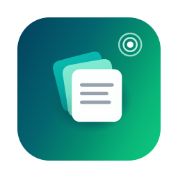

<p align="center">
  
</p>

<h1 align="center">Cliptap</h1>

<p align="center">
  Clipboard history for macOS. Tap <kbd>⌘</kbd> twice, pick, paste.<br>
  <a href="https://cliptap.app">cliptap.app</a> · <a href="https://github.com/karnstack/cliptap/releases/latest">Download</a>
</p>

---

- Text and images
- Search, pin, delete
- Keyboard first: <kbd>↑</kbd> <kbd>↓</kbd> <kbd>↩</kbd>, <kbd>⌘1</kbd>–<kbd>⌘9</kbd>
- Skips passwords marked as secret by password managers
- Stays on your Mac. No account, no tracking
- Under 1 MB, near-zero CPU when idle

## Install

1. Download `Cliptap.zip` from [Releases](https://github.com/karnstack/cliptap/releases/latest).
2. Move `Cliptap.app` to `/Applications` and open it.
3. To use the double <kbd>⌘</kbd> shortcut, allow Cliptap in
   **System Settings → Privacy & Security → Accessibility**.

Updates install from inside the app.

## Shortcuts

| Keys | Action |
| --- | --- |
| <kbd>⌘</kbd> <kbd>⌘</kbd> or <kbd>⌃</kbd><kbd>⌘</kbd><kbd>V</kbd> | Open |
| <kbd>↑</kbd> <kbd>↓</kbd> | Select |
| <kbd>↩</kbd> | Copy |
| <kbd>⌘</kbd><kbd>1</kbd>–<kbd>9</kbd> | Copy item 1–9 |
| <kbd>⌘</kbd><kbd>P</kbd> | Pin |
| <kbd>⌘</kbd><kbd>⌫</kbd> | Delete |
| <kbd>esc</kbd> | Close |

## Build

Needs macOS 14+ and Swift 5.10+.

```sh
scripts/build.sh --install
```

History lives in `~/Library/Application Support/Cliptap`.

## License

[MIT](LICENSE)
